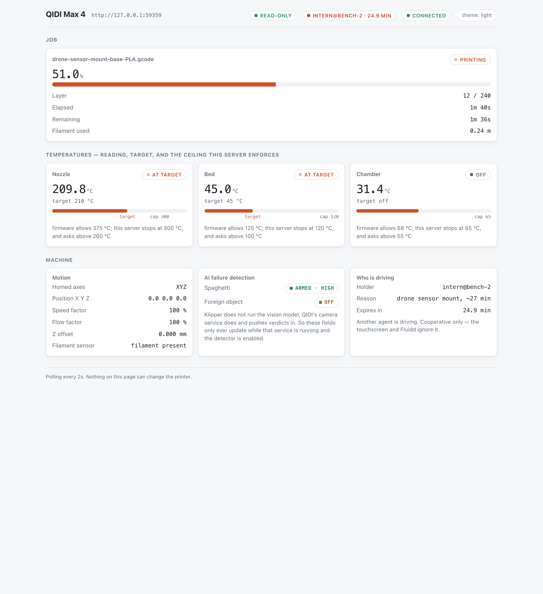

# qidi-mcp — MCP server for QIDI Max4 (Klipper / Moonraker)

An MCP server that lets AI agents observe and operate a QIDI Max4 3D printer
through Moonraker's API, with a safety layer designed for the fact that the
thing on the other end is a 400 °C hotend on a 800 mm/s gantry in a heated
chamber.

 

Created at [Exowatt](https://exowatt.com).

> **Status:** qualified end to end against **one physical QIDI Max 4** running
> the firmware documented below — read-only discovery, a full confirmation
> round trip, and a complete 27-minute PLA print through the MCP tools. It has
> **not** been qualified against any other printer, any other firmware
> version, or a machine fitted with a QIDI Box filament switcher (those tools
> are built from QIDI's published macros and a mock only — see
> [the Box guide](docs/guides/box-first-contact.md)). Read
> [docs/guides/going-live.md](docs/guides/going-live.md) before pointing this
> at hardware it has not been run against.
>
> "QIDI" and "QIDI Max 4" are trademarks of their respective owner, Qidi
> Technology. This project is independent, community-maintained tooling and is
> not affiliated with, endorsed by, or sponsored by Qidi Technology, nor by the
> Klipper or Moonraker projects.

## Try it with no hardware

The whole stack — the MCP tools, the safety gates, the dashboard — runs against
a bundled fake Moonraker, so you can see what an agent sees before any printer
is involved:

```bash
uv sync --extra dev

# terminal 1: a fake printer on loopback, mid-print by default
uv run python scripts/run_mock_printer.py

# terminal 2: point the server at it and talk to it like an agent would
QIDI_PRINTER_URL=http://127.0.0.1:7125 QIDI_TEST_MODE=1 \
    uv run python scripts/validate.py
```

`scripts/validate.py` drives real tool calls end to end (read-only mode,
confirmation tickets, the safety envelope, capability discovery) and prints what
happened. The same mock backs the automated test suite — see
[Tests](#tests) — and `qidi-dashboard` (below) can watch it live.

## Install

```bash
uv sync --extra dev
```

(Drop `--extra dev` for a plain runtime install once you are past trying it out —
`dev` additionally pulls in `pytest`, `aiohttp` for the mock, and `ruff`.)

## Configure in your MCP client

Add a `qidi` entry to your MCP client's server list. Rather than retyping the
paths by hand, have them resolved for your checkout:

```bash
.venv/bin/python scripts/mcp_entry.py            # real printer, read-only
.venv/bin/python scripts/mcp_entry.py --mock      # the bundled mock, no hardware
```

`mcp-entry.json` is the same block as a template with placeholder paths. This is
a generic MCP stdio server, so it works the same way in Claude Code, Claude
Desktop, or any other MCP client — only the surrounding config file's shape
differs:

```json
{
  "mcpServers": {
    "qidi": {
      "type": "stdio",
      "command": "/absolute/path/to/qidi-max4-mcp/.venv/bin/python",
      "args": ["-m", "qidi_mcp.server"],
      "env": {
        "QIDI_PRINTER_URL": "http://192.0.2.10:7125",
        "QIDI_READ_ONLY": "1",
        "QIDI_AUDIT_LOG": "/absolute/path/to/qidi-max4-mcp/audit.jsonl"
      }
    }
  }
}
```

### Environment variables

| Variable | Default | Purpose |
|---|---|---|
| `QIDI_PRINTER_URL` | *(required)* | Printer address; `:7125` is appended if no port given |
| `QIDI_API_KEY` / `QIDI_BEARER_TOKEN` | — | Only needed if Moonraker auth is enabled |
| `QIDI_READ_ONLY` | `0` | `1` refuses ordinary mutating tools; emergency stop remains callable |
| `QIDI_STRICT_CONFIRM` | `0` | `1` requires the two-step token for *all* guarded tiers |
| `QIDI_ALLOW_DURING_PRINT` | `0` | `1` permits motion/thermal changes mid-print |
| `QIDI_ALLOW_DANGEROUS_GCODE` | `0` | Operator switch: `1` lets `run_gcode` send deny-listed commands, still only with `allow_dangerous=true` and the token. With `0` they are refused whatever the agent passes. `run_macro` never overrides the deny-list |
| `QIDI_MAX_EXTRUDER_TEMP` | `300` | Hotend ceiling (hard-capped at the firmware's 375) |
| `QIDI_MAX_BED_TEMP` | `120` | Bed ceiling |
| `QIDI_MAX_CHAMBER_TEMP` | `65` | Chamber ceiling |
| `QIDI_CONFIRM_EXTRUDER_TEMP` | `260` | Above this, extra confirmation |
| `QIDI_MAX_JOG_DISTANCE` | `100` | Per-call jog cap, mm |
| `QIDI_MAX_EXTRUDE_DISTANCE` | `100` | Per-call extrude cap, mm |
| `QIDI_MIN_JOG_Z` | `0` | Z floor for jogs |
| `QIDI_MAX_VELOCITY` | `800` | Ceiling for `M203`, mm/s (capped at `printer.cfg` `max_velocity`) |
| `QIDI_MAX_ACCEL` | `30000` | Ceiling for `M201`/`M204`, mm/s² (capped at `printer.cfg` `max_accel`) |
| `QIDI_MAX_SQUARE_CORNER_VELOCITY` | `8` | Ceiling for `M205`, mm/s (capped at `printer.cfg`) |
| `QIDI_WEBCAM_URL` | `http://<host>/webcam/` | crowsnest/nginx snapshot base, derived from the printer host |
| `QIDI_AUDIT_LOG` | — | JSONL audit path |
| `QIDI_LEASE_ENFORCE` | `1` | Refuse mutating calls while another agent holds the printer lease |
| `QIDI_TEST_MODE` | `0` | Refuses any non-loopback host (tests and the mock quickstart) |

The full list, including identity/role options for anyone fronting this with
their own auth proxy, is in
[docs/reference/configuration.md](docs/reference/configuration.md).

## Why a safety layer at all

Moonraker's API is unauthenticated on the LAN by default (QIDI's stock
`moonraker.conf` trusts every RFC-1918 subnet) and it will happily accept
`M104 S370`, `SAVE_CONFIG`, or a file delete from anything that can reach port
7125. An LLM with that endpoint and no guardrails is one hallucinated tool call
away from a scrapped print, a crashed toolhead, or an overwritten config.

This server therefore treats printer control as a privileged operation. Every
check below is enforced in `qidi_mcp/limits.py` and `qidi_mcp/policy.py`, and has
a regression test in `tests/test_safety.py`:

| Tier | Meaning | Gate |
|------|---------|------|
| `read` | pure query | none |
| `low` | reversible (lights, beeper, fan, messages) | none |
| `motion` | moves an axis or extruder | `confirm=true` |
| `thermal` | changes a heater target | `confirm=true` + range check |
| `print` | starts/stops/alters a job | `confirm=true` |
| `destructive` | deletes files, writes config, restarts, reboots, calibrates | **two-step token** |
| `emergency` | E-stop | never gated |

Layered on top of the tiers:

- **Numeric envelope.** Temperatures, coordinates and runtime velocity/accel
  limits are range-checked before a byte leaves the process. The extruder default
  (300 °C) is below both the hardware's own `[extruder] max_temp` ceiling (375 °C)
  and QIDI's own `heater_temp_limit` macro, an independent clamp that caps extruder
  370 °C / bed 120 °C / chamber 65 °C; the bed and chamber defaults match that macro's
  clamp exactly. All three are intersected at runtime with the limits the printer
  itself reports, so the stricter of the two wins, and an override can only lower a
  ceiling, never raise one past the hardware maximum. `M201`/`M203`/`M204`/`M205`
  are held to the `printer.cfg` values (800 mm/s, 30000 mm/s², square corner 8 mm/s).
- **Interlocks** read live state: no jogging while a job is printing, no
  extrusion below `min_extrude_temp`, no motion on unhomed axes, nothing at all
  while Klipper is shut down.
- **G-code screening.** `run_gcode` and `run_macro` share one screen. Scripts are
  split on `\n` only, as Klipper splits them, and any other control character or
  Unicode line separator is refused (a tab, and a `\r` ending a line, are allowed).
  Every extended-command parameter name must be letters, digits and
  underscores, unpadded — Klipper keeps a quoted key like `" HOTEND"` verbatim,
  and QIDI's print-start macros re-render their parameters, so that used to be
  read back as `HOTEND`; such a line (or `run_macro` call) is refused outright
  instead. A name given more than once is accepted by `run_gcode` and checked
  at its last value, the one Klipper uses; `run_macro` refuses a repeated name.
  On a letter-and-number command (`G27`, `M600`, `M104`, …) the value itself is
  read exactly as Klipper keeps it, separators included: it may not contain
  `=`, a quote or a space, and an empty value on a checked parameter is
  refused — `G27 P1 Z=20` keeps `Z="=20"`; Klipper's own handlers reject that,
  but `G27`/`M600` forward it to `PARK`, whose `\|float` reads it as 0, so the
  toolhead went to Z=0 while the screen had approved Z=20 (`M117`/`M118` are
  exempt — their text is a message). Write the value straight after the letter
  (`G27 P1 Z20`, not `Z=20`); `run_macro` does the same (`M600 Z20`). Heater
  targets (including QIDI's `SET_HEATER_TEMPERATURE_SCALED`, the decimal spellings
  of built-ins QIDI renames such as `M104.6245197`, and the stock macro parameters
  that reach a heater — `PRINT_START`/`PRINT_START_SET`, `CLEAR_NOZZLE`, `M600 R`,
  `EXTRUSION_AND_FLUSH`, `M4029 S`, `M603`/`M604 S`), kinematic limits, absolute
  coordinates (`G0`–`G3`, tracked per `G90`/`G91` line so the envelope — including
  the Z floor — holds until the next `G90`; `PARK`/`G27`/`M600`/`PAUSE` always, since
  they switch to `G90` themselves) and G-code offsets (`SET_GCODE_OFFSET`/`M290`,
  capped at ±5 mm) are range-checked. The Box's firmware commands (`E_LOAD`,
  `MULTI_COLOR_*`, `EXTRUDER_LOAD`, …) have unpublished parameters, so any whose
  name could hold a temperature is held to the extruder envelope on the
  load/unload family and refused outright on the rest. These value checks run
  **before** the deny-list, so a deny-listed macro's planted temperature or
  coordinate (`PRINT_START_SET`, `_PRINT_START_PHASE_INIT`, `M4029`, `M603`/`M604`,
  `PAUSE`/`_PARK_INNER`) stays bounded even with the operator switch on; a handful
  of commands that would defeat the value checks themselves (`SET_GCODE_VARIABLE`,
  the heater-scaling macros, the deferred-command macros, the wait-wrapper
  internals) are in `ALWAYS_DENIED_GCODE_COMMANDS`, which the operator switch can
  **never** unlock. `SET_FILAMENT_SENSOR ... ENABLE=0` (the primitive behind
  `DISABLE_ALL_SENSOR`) is denied; `ENABLE=1` is fine. Raw print starts
  (`SDCARD_PRINT_FILE`, `M23`, `M24`, `M32`) are denied in favour of `start_print`/
  `resume_print`, which claim the lease and bind the checked file. A deny-list
  refuses `SAVE_CONFIG`, `FORCE_MOVE`, `SET_KINEMATIC_POSITION`, TMC current writes,
  `PID_CALIBRATE`, every `rename_existing` target (including its decimal alias), the
  stock vendor macros that reach those primitives, and friends. Overriding the
  deny-list needs the operator's `QIDI_ALLOW_DANGEROUS_GCODE=1` **and** the agent's
  `allow_dangerous=true` and token; `run_macro` never overrides it. Macros are
  screened by name and parameters, not expanded, so a user-defined macro is only
  as safe as its name and listed parameters — see
  [known limitations](docs/security/README.md#known-limitations).
- **Read-only mode** (`QIDI_READ_ONLY=1`) refuses ordinary mutating tools (emergency stop is exempt) — the
  safest way to let an agent watch a print it must not touch.
- **A printer lease** so two agents cannot drive one machine. Each agent runs its
  own server process, so the claim is stored *on the printer* (a namespace in
  Moonraker's database) — the only state they all share. Holding it refuses another
  agent's mutating calls by name, and `start_print` requires claiming the machine
  first. Cooperative, not a lock: the touchscreen and Fluidd ignore it, and prints
  started there do not take the lease in this release (the during-print
  interlock still refuses motion/thermal changes while any job runs, from any
  agent, regardless of who holds the lease). See
  [sharing the printer](docs/guides/sharing-the-printer.md).
- **Audit log**: every non-read action appended as JSONL with tier, args and
  outcome.

A tier is not always fixed. Ten tools choose one per call, so the count above is
the set that *always* needs a token, not the set that ever can. `set_temperature`
is ungated at 0 (turning a heater off is safety-positive), ordinary at a normal
target, and escalates to a token past the confirm threshold; `run_gcode` spans
three tiers by what the line does; `upload_gcode`, `move_file` and `copy_file`
escalate when they would overwrite something.

## Tools

101 tools in eleven modules (verified by querying a mock-backed server:
38 read-only, 24 carrying the destructive annotation, none unannotated). `R` =
read query, `W` = mutation whose confirmation depends on its tier, `D` = two-step
`confirm_token`. Low-tier actions need no confirmation by default; strict mode
escalates the guarded tiers.

Of those 24, **22 always require a token**, and the two exceptions are both
deliberate. `emergency_stop` is annotated destructive because it truly is — it kills
the print and shuts Klipper down — but it sits in its own never-gated tier, exempt
from confirmation, read-only mode and interlocks alike; a safety mechanism you have
to argue with is not one. `abort_macro` is the gentle stop for a runaway macro, so it
takes a single `confirm=true` rather than a round trip. These counts are asserted by
`tests/test_docs.py` and by the `safety-invariants` CI job, because they have
drifted before.

**Discovery & status** (13, all R) — `get_printer_status`, `get_capabilities`,
`get_temperatures`, `get_position`, `get_job_status`, `get_printer_config`,
`query_objects`, `list_gcode_commands`, `get_gcode_log`,
`get_temperature_history`, `get_system_info`, `get_audit_log`,
`get_safety_policy`

**Thermal** (3) — `set_temperature` W, `wait_for_temperature` R, `cooldown` W

**Motion** (8, all W) — `home_axes`, `move_absolute`, `move_relative`,
`set_z_offset`, `extrude_filament`, `set_speed_factor`, `set_flow_factor`,
`motors_off`

**Print jobs** (11) — `start_print` D, `pause_print` W, `resume_print` W,
`cancel_print` D, `get_print_history` R, `get_history_totals` R,
`get_job_queue` R, `check_print_fit` R, `queue_jobs` W, `remove_queued_jobs` D,
`control_job_queue` W

**Files** (11) — `list_gcode_files` R, `get_file_metadata` R,
`list_file_roots` R, `list_directory` R, `download_file` R, `upload_gcode` W,
`move_file` W, `copy_file` W, `create_directory` W, `delete_file` D,
`delete_directory` D

**Devices, fans & lights** (10) — `list_fans` R, `list_devices` R,
`query_filament_sensor` R, `set_fan_speed` W, `set_case_light` W,
`set_output_pin` W, `set_led` W, `beep` W, `display_message` W,
`set_filament_sensor` W

**Calibration & probing** (10) — `get_bed_mesh` R, `query_probe` R,
`query_endstops` R, `probe_accuracy` W, `screws_tilt_calculate` W,
`z_tilt_adjust` W, `set_input_shaper` W, `bed_mesh_calibrate` D,
`bed_mesh_profile` D, `input_shaper_calibrate` D

**Camera** (2, both R) — `get_webcam_snapshot` (returns an actual image for a
vision model to inspect), `list_webcams`

**Sharing the printer** (5) — `get_printer_lease` R, `acquire_printer_lease` W,
`renew_printer_lease` W, `release_printer_lease` W, `break_printer_lease` D
(force-releasing someone else's claim is audited with your name)

**System & escape hatches** (12) — `get_klipper_log` R, `abort_heating` W,
`abort_macro` W, `emergency_stop` emergency (never gated), `restart_firmware` D,
`restart_klipper_host` D, `restart_service` D, `reboot_printer` D,
`shutdown_printer` D, `run_gcode` D (line-screened), `run_macro` D,
`resume_after_power_loss` D

Three of these exist only because QIDI's Moonraker fork adds them, verified
against `QIDI_MAX4`'s own `klippy_apis.py`. `abort_heating` (breakheater) and
`abort_macro` (breakmacro) are **soft aborts**: they escape a stuck heater wait
or a runaway macro while leaving the printer alive, where `emergency_stop`
shuts Klipper down and needs a firmware restart to come back. An agent should
reach for these first. `get_capabilities` reports `features.soft_abort` so it
knows whether they are available; on stock Klipper they degrade to
"not supported" rather than pretending to work.

**QIDI-specific (Max4)** (16) — `chamber_heater` W, `set_polar_cooler` W,
`clean_nozzle` W, `get_box_status` R, `list_box_filament_options` R,
`set_box_slot_filaments` W, `load_box_slot` D, `set_box_option` W,
`get_saved_variables` R,
`get_filament_presets` R, `get_ai_detection_status` R, `set_ai_detection` W,
`load_filament` D (staged heat/push/purge),
`unload_filament` D, `qidi_bed_level_calibrate` D (M4029), `save_z_offset` D

The **QIDI Box** (four-spool filament switcher) tools — `get_box_status`,
`load_box_slot`, `set_box_option`, and `cooldown(also_box_heater=true)` — were built
from QIDI's published macros and a mock. On the one physical qualification run (see
Status above), the **read-only** tools were run against a real Max4 with a Box and
worked (status, slot names, filament table, queue previews); **nothing has been
written to or moved on a real Box.** That run also found that this firmware has none
of `E_LOAD`, `E_UNLOAD` or `DISABLE_BOX_HEATER` — it has `MULTI_COLOR_*` commands with
unpublished parameters — so `load_box_slot` refuses on it, and the Box was present but
disabled (`enable_box = 0`). The tools discover the Box at runtime (it must exist as
both `box_count > 0` and a live `box_extras` object, as QIDI's own macros require) and
say which half is missing. Read
**[The QIDI Box: first contact](docs/guides/box-first-contact.md)** before writing to a
real machine.

**Saying what is in each slot.** `get_box_status` returns one readable line per slot
(`slot 0 (unit 1, position 1): PLA Matte, black (QIDI)`). To change them, call
`set_box_slot_filaments` with plain names:
`assignments=[{"slot": 0, "filament": "PETG Basic", "color": "dark blue"}]`
(`vendor` is optional; only the fields you name change). Names are resolved against
the printer's own `officiall_filas_list.cfg`, so the ids written are ones the firmware
already knows; `list_box_filament_options` searches that table. An ambiguous name
(`ABS`) is an error that lists the candidates, a bare material (`PETG`) resolves to
its "Basic" profile and says so, and a colour snaps to the nearest of the printer's 24
swatches and says so. The first call previews exactly what it would write; repeat it
with `confirm=true` to apply, and it reads the result back. It is refused during a
print and cannot clear a slot.

**Queueing prints.** `queue_jobs` accepts loose names (`["benchy", "bracket abs"]`),
fails the whole call on an unknown or ambiguous one, and its preview shows what each
resolved to, the print time, and whether the Box's filament suits the file.
`check_print_fit` does that comparison on its own, and `start_print` includes it in
its confirmation ticket. The comparison is advisory — which slot the printer feeds for
which slicer tool is not published, so it checks materials and colours and never
blocks. `get_job_queue` lists the queue in plain lines with total time, and reports
whether the queue advances by itself (`automatic_transition`).

AI failure detection (`noodle` = spaghetti, `foreign` = debris on the plate)
ships **disabled** on a stock Max4. Enabling a detector is free; disabling one
removes a safety net and needs `confirm=true`. Klipper does not run the vision
model — QIDI's camera service does and pushes verdicts in via
`SET_AI_DETECT_RESULT`, so a count of 0 from a *disabled* detector means "nothing
ever reported", not "the print is fine".

## Live dashboard

Everything else here is for an agent to call. This is for you to watch:

```bash
QIDI_PRINTER_URL=http://127.0.0.1:7125 uv run qidi-dashboard
# or against the bundled mock from "Try it with no hardware" above, same URL
```

`QIDI_PRINTER_URL` is required — the dashboard refuses to start without it
(same validation as the server). It opens a browser on `127.0.0.1:8770` and polls every 2s. Two things worth
knowing:

*   **It cannot move the printer.** The dashboard builds the server with
    `read_only` forced on regardless of your environment, so it is the same code
    path an agent uses with the write half bolted shut. Launching it with
    `QIDI_READ_ONLY=0` already exported does not change that.
*   **It shows the envelope, not just the readings.** Each heater meter draws the
    temperature, its target, *and* the ceiling this server enforces — e.g. the
    nozzle track is captioned "firmware allows 375 °C; this server stops at
    300 °C, and asks above 260 °C". The gap is the point of the project, so it is
    on screen rather than buried in a config file.

It also reports job progress and layer, motion and Z-offset, filament sensor
state, and whether the AI failure detectors are armed. Follows light/dark
automatically; `?theme=light` or `?theme=dark` pins it for a screenshot or a
shared link. `QIDI_DASHBOARD_HOST` / `QIDI_DASHBOARD_PORT` override the bind
(loopback by default on purpose — this exposes printer state), and
`QIDI_DASHBOARD_NO_BROWSER=1` stops it opening a tab.



Two routes, both GET:

| Route | Returns |
|---|---|
| `/` | The page. Single file, no external requests, no web fonts. |
| `/api/state` | Aggregated JSON — the same shape the page consumes, so `curl \| jq` works if you want printer state in a shell script without writing an MCP client. |

The screenshots above are generated from the bundled mock, not captured by hand
against a real machine, and the same script asserts the layout does not scroll
sideways at three viewports:

```bash
.venv/bin/python scripts/screenshots.py --check
```

## Tests

The suite runs entirely against an in-process mock Moonraker (aiohttp) that
mimics the Max4's object model, and a `conftest` guard that **blocks any socket
to a non-loopback address**, so a test run can never touch a real printer.

```bash
uv run pytest -q     # 777 tests (901 with the optional upstream sources fetched), a couple of minutes on an idle machine
```

Coverage is deliberately weighted toward refusals rather than happy paths:
every temperature ceiling, every interlock, token replay and cross-tool token
reuse, G-code screen bypass attempts, path traversal, read-only mode, and the
stdio transport itself. The mock's object model, macro names and limits are
transcribed from QIDI's published `printer.cfg`, so a passing test exercises
the shapes the real machine returns. `scripts/run_mock_printer.py` (above) is
the same mock, exposed as a standalone process rather than a test fixture.

## Going live

Read-only discovery has been qualified against the physical Max 4; no write has
been commanded beyond the single qualification print described under Status.
When you're ready:

1. Start read-only: `QIDI_READ_ONLY=1`, then `get_capabilities` and
   `get_printer_status` to confirm discovery matches your firmware.
2. Drop read-only, try `low`-tier actions (`set_case_light`, `beep`).
3. Then thermal/motion with the printer watched, then a real print.

`emergency_stop` works in every mode, including read-only. See
[docs/guides/going-live.md](docs/guides/going-live.md) for the full walk-through.

## What adversarial review found

The safety layer was audited by independent agents told to break it and to prove
every claim by running code. **Twelve real bugs came out of it**, each fixed with
a regression test that fails if the fix is reverted. Every exploit was re-run
after the fix to confirm it is actually closed, rather than trusting the diff.

The full findings, the evidence, and the fix for each live in
**[`docs/security/`](docs/security/README.md)** — including the proof scripts,
which can be re-run. The most serious nine:

| Severity | Bug |
| --- | --- |
| HIGH | `N1 SAVE_CONFIG` bypassed the deny-list: the screen split on whitespace, but Klipper *skips* a leading line number. |
| HIGH | `run_gcode` screened command *names* but never argument *values*, so `M104 S374` reached the printer from the same server that refused `set_temperature(374)`. |
| HIGH | Three guards were written `if abs(x) > cap`, which **approves NaN** — every comparison against NaN is False. |
| HIGH | The deny-list only knew *upstream's* names, missing QIDI's `SAVE_CONFIG_QD` and `RESET_HEATER_SCALING`. |
| HIGH | Interlocks were judged on a 0.75 s cache, so a refused call's retry was authorised against pre-refusal state. |
| HIGH | Any HTTP 503 was read as "nothing is printing" — but Moonraker returns the same 503 while a print continues. |
| HIGH | A failed capability discovery was cached 300 s as "no chamber heater", so `cooldown` left a ~300 W heater on. |
| HIGH | A `start_print` token bound only the *filename*, so the file's contents could change inside the confirmation window. |
| HIGH | A negative `QIDI_MAX_*_TEMP` inverted the range, producing a server that could not turn a hot heater **off**. |

A later review, during the open-source export, reproduced five more bypasses with
the token redeemed — `run_macro` never range-checked its parameters, QIDI's
`SET_HEATER_TEMPERATURE_SCALED` and `M201`/`M203`/`M205` were unchecked,
`allow_dangerous` needed no operator, and fifteen stock vendor macros reached
restricted primitives undenied. All are closed and regression-tested; see
[the security review](docs/security/README.md#envelope-bypasses-found-during-the-oss-export-review).

A second review of that same fix found five more ways past it, all closed and
regression-tested in `tests/test_envelope_bypasses.py` (sections 7–9): the raw
built-ins QIDI's wrapper macros hide behind `rename_existing` (`M104.6245197
S374`) were reachable unchecked; a line separator other than `\n` (`\r`,
`\x0b`, `\u2028`, …) hid a second value on what the screen saw as two harmless
lines; several stock macro *parameters* — not just names — carried a temperature
into a heater (`M600 R374`, `EXTRUSION_AND_FLUSH HOTEND=374`); `M109`/`M190`
forwarded every parameter into an internal wrapper, so `M109 S200 R1 M140` set
the bed to 200 °C through a parameter named `M`; and several deferred or
unbounded commands (`GCODE_ON_PRINT_STATUS`, `M0`/`M25`/`M601`, `M1002`, `M900`,
the closed-loop stepper-current commands, and an unbounded `SET_GCODE_OFFSET`/
`M290`) were not covered. L5 section (e) now traces every parameter of every
stock macro to the primitive it reaches (78 flows, 0 uncovered); section (f)
checks every `rename_existing` target is denied. See
[the second review](docs/security/README.md#second-review-bypasses-left-after-the-first-fix)
for the full table and fixes.

A third review, with `QIDI_ALLOW_DANGEROUS_GCODE` both unset and set, found six
more ways past the same gates, all closed and regression-tested in
`tests/test_envelope_bypasses.py` (section 10): padded or quoted parameter
names (`PRINT_START HOTEND=200 " HOTEND"=374 BED=60`) that Klipper keeps
verbatim and a forwarding macro re-renders as the plain name, reaching
`M109 S374`; `E_LOAD SLOT=0 S=374` and the Box's other firmware commands
reaching the wire through unpublished parameters; `PRINT_START_SET`,
`_PRINT_START_PHASE_INIT`, `M4029 S`, `M603`/`M604 S` and `PAUSE`/`_PARK_INNER`
X/Y/Z staying open to a planted value with the operator switch **on**, because
only the deny-list (which the switch reopens) covered them; `SET_FILAMENT_SENSOR
... ENABLE=0` reaching the sensor it disables; raw print starts
(`SDCARD_PRINT_FILE`, `M23`, `M24`, `M32`) skipping `start_print`'s lease and
file binding; and the Z floor lapsing for every line after a `G91` anywhere in a
script, rather than only until the next `G90`. The fixes: parameter names are
now validated against `[A-Z0-9_]+`; value checks run **before** the deny-list,
and the handful of commands that would defeat them outright
(`SET_GCODE_VARIABLE`, the heater-scaling macros, …) are in
`ALWAYS_DENIED_GCODE_COMMANDS`, which the operator switch can never unlock; and
`G90`/`G91` are tracked line by line. See
[the third review](docs/security/README.md#third-review-the-operator-switch-box-temperatures-and-parameter-names)
for the full table.

One reviewer drove Klipper's real `GCodeDispatch` as an oracle across 154,371
generated command spellings and found zero divergences in the resolved command
name, which is the kind of evidence worth having on a safety boundary. That
oracle was Klipper's `klippy/gcode.py` (GPLv3). It is **not bundled** in this
Apache-2.0 export. To rerun the standalone differential proofs, first run
`bash scripts/fetch_upstream_sources.sh`, which retrieves a pinned v0.13.0 parser
into Git-ignored `research/upstream/`; see [the provenance inventory](research/upstream/README.md).
The internal record of this result did not pin the precise parser revision used
for the historical 154,371-case run. Rerunning `L4_fuzz.py` against the pinned
v0.13.0 fetch checked 320,424 single-line inputs (current deny-list, up from
271,344 before the safety-envelope-bypass fixes) with zero name divergences
and zero safety bypasses. The installed package never imports the upstream parser.

The recurring theme is worth stating: **each bug was a place where the code
guessed instead of knowing.** It guessed how Klipper parses a line, guessed that
cached state was still true, guessed what a 503 meant, guessed that undiscovered
hardware was absent, guessed that a filename identified a file. The fixes all
replace a guess with either a real query or an honest "unknown" that fails safe.

Two rules came out of this and are worth keeping:

1. **A screen that parses its input differently from the executor is not a
   screen.** All G-code classification goes through `klipper_command_name()`.
2. **A guarantee that holds only on the paths you remembered to guard is not a
   guarantee.** The raw escape hatch (`run_gcode`, `run_macro`) now applies the
   same temperature, velocity/accel and axis envelope as the dedicated tools to
   every heater, limit and motion command it can parse, to the decimal spellings
   of renamed built-ins, and to the stock QIDI macro parameters that reach one —
   value-checked before the deny-list, so the operator switch cannot reopen a
   planted value. It does not cover `G0`–`G3` coordinates after a `G91` (until the
   next `G90`; a script is assumed to start in absolute mode, so a previous
   script's `G91` makes the check stricter, not looser), Box parameters whose
   names do not look like a temperature, arc centres, `G92`, print files (the
   envelope governs this server's raw path, not what a slicer wrote), or macros
   the stock config does not define; see
   [the residual limits](docs/security/README.md#known-limitations).

## Historical firmware research (not a current compatibility survey)

This was the original question, so it is worth stating plainly. The research
checkout under `research/` was collected in September 2026 and found **no
open-source OS/firmware replacement supporting the Max4**. Firmware projects
move, so re-check current releases before acting on the table:

| Project | Targets | Max4? |
| --- | --- | --- |
| [FreeDi](https://github.com/Phil1988/FreeDi) | X-Max3, X-Plus3, X-Smart3, Q1 Pro, Plus4 | No |
| FreeQIDI | X-3 series | No |
| OpenQ1 | Q1 Pro only | No |
| [Qidi-Max-4-Optimized](https://github.com/thelegendtubaguy/Qidi-Max-4-Optimized) | **Max4** | Macros/config only — not firmware |
| Kalico ports | Plus4, Q2 | No verified Max4 port |

The one Max4-specific community project is a Klipper macro and slicer-profile
overlay installed over SSH; it does not replace the OS, Klipper, Moonraker, or
MCU firmware. So this server targets **stock firmware** — which is the right
call anyway, since it is what the printer runs. The platform facts below come
from QIDI's published config at commit `47fc14c`
(https://github.com/QIDITECH/QIDI_MAX4/tree/47fc14cefe064dbd30b90582429fe650883ae900),
not from querying your machine.

Stock platform, for reference: Debian 11 Bullseye, kernel 5.10.160, aarch64,
4× ARM Cortex-A35 on a Rockchip SoC, separate mainboard and toolhead MCUs (the
latter on `/dev/ttyS4` at 500000 baud). Moonraker reports API version 1.4.0 and
its Klipper is closest to upstream v0.13.0 with QIDI patches — the exact strings
the bundled mock returns are `MOONRAKER_VERSION = "v0.8.0-266-gd5b0e7f"` and
`KLIPPER_VERSION = "v0.13.0-qidi-284-g5d1b0f3f"` (`tests/mock_moonraker.py`);
the physical qualification run matched these.

### A security note about your printer

Stock Moonraker binds `0.0.0.0:7125` and lists the private LAN ranges as
`trusted_clients`, with no `force_logins`. **Anything on your LAN can control
the printer with no authentication** — no API key needed, which is why this
server does not require one. That is a property of the printer, not of this
server, but it is worth knowing: the safety envelope here constrains *this*
client, and does nothing about any other. QIDI's `algo_app` also exposes an AI
detection API on port 9010. `crowsnest.conf` advertises the camera on 8080, but
on the reference Max4 that port is closed — nginx proxies the stream at
`/webcam/` on :80 instead, which is what `QIDI_WEBCAM_URL` defaults to
(see `qidi_mcp/config.py`).

## Hardware reference (Max4)

Transcribed from [QIDITECH/QIDI_MAX4](https://github.com/QIDITECH/QIDI_MAX4)
`config/printer.cfg`: CoreXY, 385×405×342 mm build volume (`position_max`
392/410/342), extruder `max_temp` 375 °C with `min_extrude_temp` 135,
bed `max_temp` 125, `[heater_generic chamber]` `max_temp` 68, 9×9 bed mesh over
15–375 mm, dual Z with `z_tilt`, closed-loop X/Y, QIDI's `probe_air` inductive
probe, filament switch sensor, and a `multi_color_controller` (declared on every
Max4, with or without a Box; a Box additionally needs `box_extras` and `box_count`)
for up to four Box units. The firmware's own `heater_temp_limit` macro caps extruder/bed/chamber at
370/120/65 °C.

Moonraker on stock firmware: port 7125, `trusted_clients` covering all private
subnets, `[octoprint_compat]`, `[history]`, `[timelapse]` enabled and
`[update_manager]` **absent**; camera via crowsnest on 8080.

## Prerequisites

No proprietary SDK is required or bundled. You need:

- A QIDI Max 4 (or the bundled mock — see "Try it with no hardware" above) on
  its stock firmware, reachable over HTTP from wherever this server runs.
- Python ≥3.11 and [uv](https://docs.astral.sh/uv/).
- Optionally, Google Chrome or Chromium to regenerate the dashboard screenshots
  (`scripts/screenshots.py`).

## License

Original code is licensed under [Apache-2.0](LICENSE). No third-party GPLv3
firmware/configuration, docs or parser is included. [NOTICE](NOTICE) and the
[research provenance index](research/upstream/README.md) explain how to fetch
the pinned source material separately for local verification.

## Contributing

See [CONTRIBUTING](https://github.com/couplet-physical-ai/.github/blob/main/CONTRIBUTING.md). Contributions require DCO sign-off (`git commit -s`); no CLA is required.

## Security

Please report vulnerabilities privately using [GitHub private vulnerability reporting](https://github.com/couplet-physical-ai/qidi-max4-mcp/security/advisories/new). See the [security policy](https://github.com/couplet-physical-ai/.github/blob/main/SECURITY.md); do not open a public issue.
